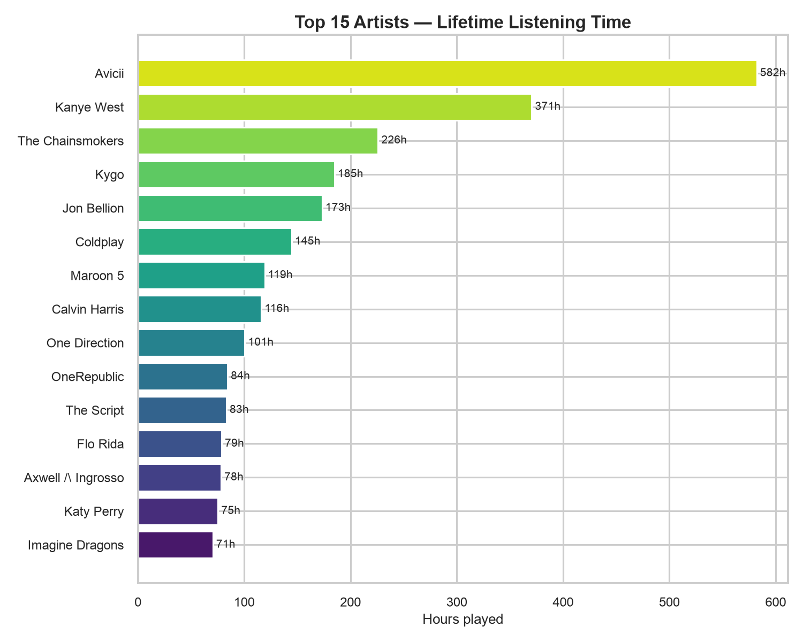
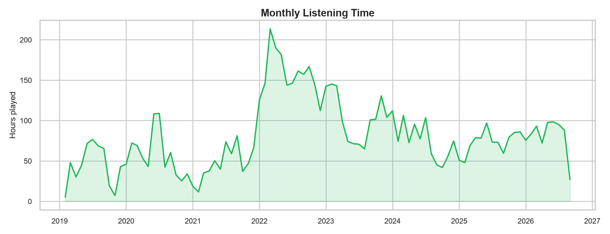
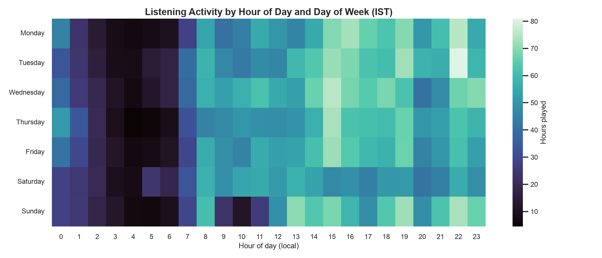
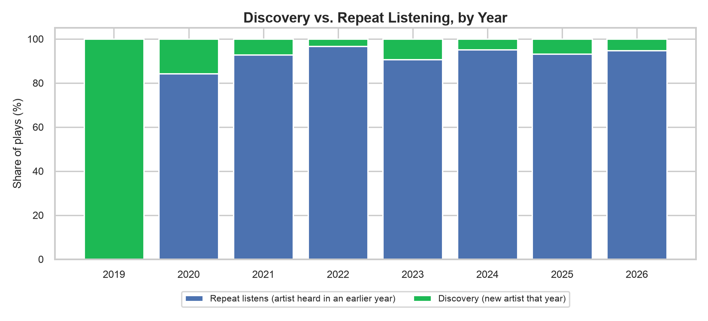
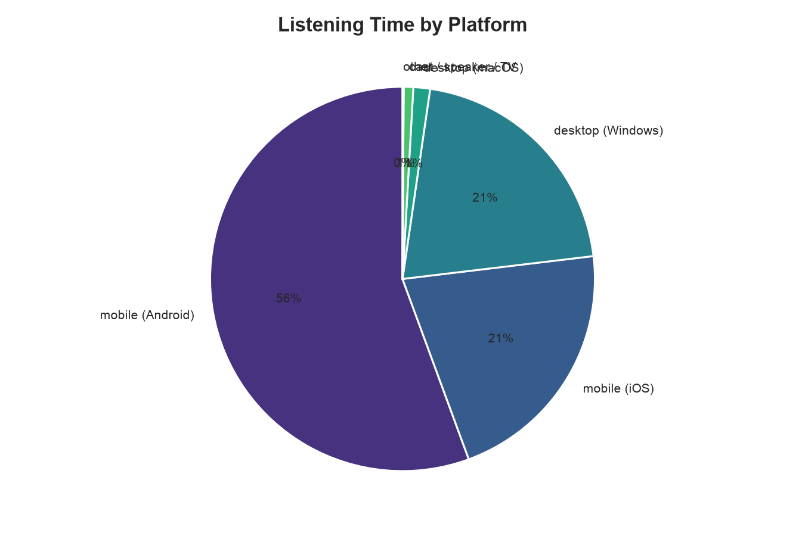
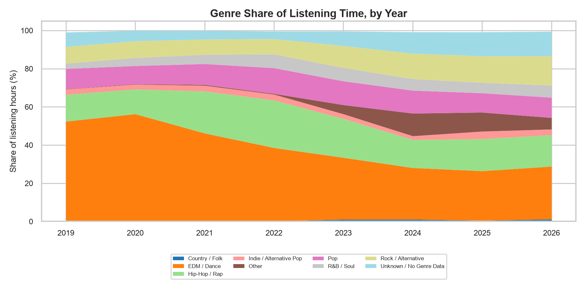
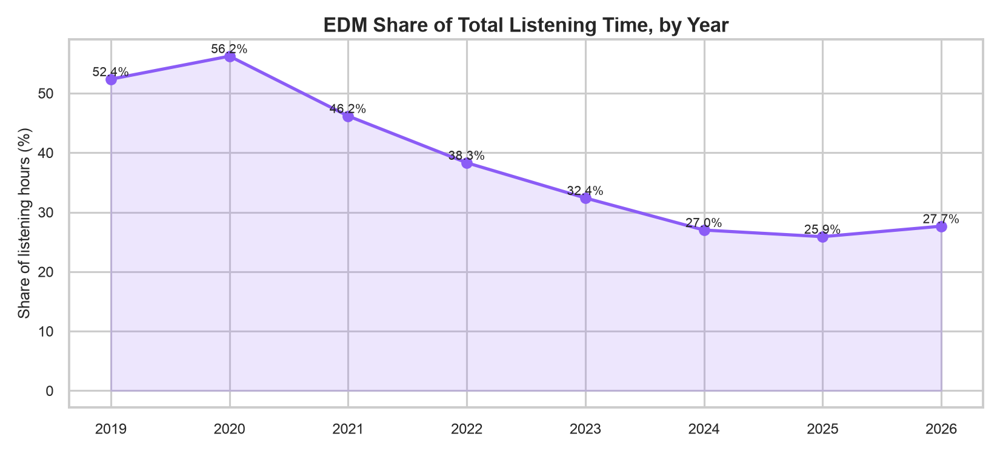
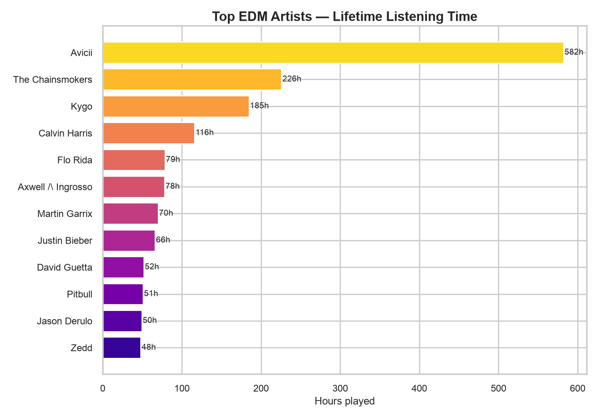

# Spotify Listening History Analysis

7.5+ years of my own Spotify Extended Streaming History — Feb 2019 through
Sept 2026 — analyzed for real listening patterns, not the once-a-year
highlight-reel version Spotify Wrapped gives you. This includes a dedicated
deep dive into my EDM listening specifically, since that's the genre I
suspected (going in) makes up an outsized share of my total time.

Methodology, tech stack, and how to re-run this pipeline are in
[`README.md`](README.md). This file is the findings.

## The data, in short

- **7,398.8 hours** of music, after filtering out plays under 30 seconds
  (the standard threshold for stripping out accidental taps and near-instant
  skips — see [Limitations](#limitations) for the exact effect of that
  filter).
- **Feb 28, 2019 → Sept 8, 2026** — every play in that window, across
  **2,577 unique artists** and **9,859 unique tracks**.
- 7,398.8 hours is **~308 days** of continuous playback — over 11% of the
  entire calendar span was spent with music playing.

---

## Key findings

### 1. Listening has a clear favorite, and it isn't close

**Avicii** is the single most-played artist by a wide margin: **582.3 hours**
across 9,858 plays — that's **57% more** than the #2 artist. The full top 5:

| Rank | Artist | Hours | Plays |
|---|---|---|---|
| 1 | Avicii | 582.3 | 9,858 |
| 2 | Kanye West | 370.6 | 6,600 |
| 3 | The Chainsmokers | 226.0 | 4,247 |
| 4 | Kygo | 184.9 | 3,415 |
| 5 | Jon Bellion | 173.3 | 3,463 |

The top track is **"Levels (Original Version)" by Avicii** — 175.7 hours
across 2,099 plays, on its own. Including the Radio Edit (44.5h), Avicii's
"Levels" alone accounts for **220 hours** — essentially 3% of all listening
time in this entire dataset from two versions of one song. At the album
level, *Levels* by Avicii is the single most-played album lifetime at 239.4
hours, ahead of *Donda* (Kanye West, 105.1h) and *Graduation* (Kanye West,
101.6h).

### 2. One year — 2022 — stands out sharply from the rest

Yearly totals show 2022 as a clear outlier:

| Year | Hours |
|---|---|
| 2019 | 479.8 |
| 2020 | 695.6 |
| 2021 | 557.5 |
| **2022** | **1,888.8** |
| 2023 | 1,248.1 |
| 2024 | 918.9 |
| 2025 | 878.9 |
| 2026* | 731.1 |

*2026 is partial — the export ends Sept 8, 2026.*

2022 alone accounts for over **25% of all lifetime listening hours**, more
than triple any of the three years before it. The monthly trend makes this
even clearer — **March 2022 is the single highest-volume month in the
entire dataset at 213.4 hours**, nearly double a typical month elsewhere in
the timeline.

This wasn't one artist spiking — it's a broad, simultaneous increase across
already-favorite artists. In March 2022 specifically: Kanye West (51.7h),
Avicii (28.2h), The Chainsmokers (20.7h), Jon Bellion (14.9h), Coldplay
(13.0h), and Kygo (12.6h) were all up together. Whatever changed that month
(more time overall spent listening, a new device, a routine change) affected
listening broadly rather than being driven by one release or artist.

### 3. Listening is concentrated late morning through late night, on a 7-day cycle

Using the local time zone (Asia/Kolkata — see [Limitations](#limitations)
for why), listening is fairly flat across the whole day and week — there's
no single dominant peak, but a consistent trough overnight:

- **Overnight (2 AM–5 AM) is consistently the quietest window** across every
  day of the week — unsurprising, but useful as a sanity check that the
  timestamp/timezone handling is correct.
- Listening is otherwise fairly evenly spread from ~8 AM through ~11 PM,
  with the single busiest hour-of-day overall being **10 PM (475.8
  cumulative hours)**, closely followed by 3 PM (476.0h) and 7 PM (460.7h) —
  no sharp "commute" or "work break" spike, more a broad all-day-and-evening
  listening habit.
- By day of week, **Wednesday (1,133.5h)** and **Tuesday (1,111.2h)** are
  the highest-volume days lifetime, with **Saturday (974.3h)** the lowest —
  a mild weekday-leaning pattern, though the gap between the highest and
  lowest day is under 15%, so this isn't a dramatic effect.

### 4. Skip behavior — one real signal, and one likely data artifact

Two different skip-related signals are in this dataset, and they tell
different stories:

- **Plays cut short under 30 seconds: 40.7%** of all raw plays (236,487
  music plays). This is measured directly from `ms_played` and is reliable
  across the whole date range — it's also the basis for the exclusion filter
  used everywhere else in this analysis.
- **Spotify's own `skipped` flag: 22.6%** overall — but broken down by year,
  this one has a pattern that looks like a data-collection artifact rather
  than a real behavior change:

| Year | Skip-flag rate |
|---|---|
| 2019 | 0.0% |
| 2020 | 0.0% |
| 2021 | 0.0% |
| 2022 | 7.3% |
| 2023 | 44.2% |
| 2024 | 41.9% |
| 2025 | 54.4% |
| 2026 | 44.7% |

An exact **0.0%** for three consecutive years, followed by a jump to
double-digit and then 40–50%+ rates, is very unlikely to reflect three years
of literally never skipping a single track. The far more plausible
explanation is that Spotify's `skipped` field simply wasn't being populated
by whatever client/app version was in use during 2019–2021, and started
being recorded reliably from 2022 onward. **This is flagged here rather than
smoothed over** — the `skipped`-flag-by-year numbers should be read as "not
meaningfully measurable before 2022," while the 30-second cutoff rate above
is the more trustworthy signal across the full range.

### 5. This is a repeat listener, not a discoverer — but discovery still happens within favorites

Excluding 2019 (the first year in the dataset, where every artist is
trivially "new"), only a small share of plays each year are of an artist
never heard before:

| Year | New-artist share of plays | New distinct tracks that year |
|---|---|---|
| 2020 | 15.7% | 1,396 |
| 2021 | 7.2% | 672 |
| 2022 | 3.3% | 1,637 |
| 2023 | 9.3% | 1,142 |
| 2024 | 4.8% | 1,026 |
| 2025 | 6.9% | 1,279 |
| 2026 | 5.2% | 1,229 |

The pattern is consistent: **90%+ of plays in most years are repeat
listening to already-known artists.** But the "new distinct tracks" column
tells a more specific story — even in 2022, the year with the *lowest* new-
artist share (3.3%), over 1,600 previously-unheard tracks were played. So
discovery here mostly isn't "finding new artists" — it's **finding new
songs and albums from artists already in heavy rotation** (e.g., a new
Kanye West or Avicii release), rather than branching out to unfamiliar
names.

### 6. Listening is overwhelmingly mobile, and specifically Android

| Platform | Hours | Share |
|---|---|---|
| Mobile (Android) | 4,116.1 | 55.6% |
| Mobile (iOS) | 1,576.9 | 21.3% |
| Desktop (Windows) | 1,541.4 | 20.8% |
| Desktop (macOS) | 101.1 | 1.4% |
| Cast / speaker / TV | 59.1 | 0.8% |
| Other | 4.2 | 0.1% |

Mobile listening (Android + iOS combined) accounts for **77% of all hours**,
with desktop making up almost all the rest. The presence of both iOS and
Android at meaningful volumes suggests a device change at some point in this
history, though pinning down exactly when would need a closer look at the
raw platform strings by date — not pursued here since it's a secondary
detail relative to the rest of the findings.

---

## EDM deep dive

*(This section is the project's specific focus.)*

### Genre data coverage — and a mid-project data-source pivot

Genre isn't part of the raw Spotify export — it has to be resolved
per-artist from an external source. The original plan was Spotify's own
Web API, and that path is still in this repo (`src/fetch_genres.py`)
because it surfaced a real, worth-documenting debugging story (see
`README.md`'s "Known issues resolved"). But it turned out to be a dead
end for this project, for two independent reasons discovered while
building it:

1. A sustained rate-limit wall that did not clear even after a genuine
   24+ hour wait — ruling out both a UTC-midnight and an IST-midnight
   reset.
2. Inspecting the artists that *did* resolve before the wall hit showed
   every one had an **empty** genre list — including globally famous,
   normally heavily-tagged acts (*NSYNC, 21 Savage). Checking the
   Spotify Developer Dashboard confirmed this app is in **"Development
   mode,"** Spotify's most restricted access tier — which explains both
   symptoms at once, and means no amount of waiting or clever pacing
   would have fixed it.

Given that, genre resolution was rebuilt around **MusicBrainz**
(`src/fetch_genres_musicbrainz.py`) — a fully open, public,
Creative-Commons-licensed music database with no API key or approval
process, and a documented, stable rate limit (1 request/second) instead
of Spotify's opaque one. This is a genuine data-source substitution, not
a tweak, and it comes with its own honest trade-offs (see
[Limitations](#limitations)) — most notably that MusicBrainz's genre data
is a mix of a curated genre list and a community tag folksonomy, which is
broader but noisier than Spotify's algorithmic tags. One real consequence
of that noise: an early version of the genre-bucketing logic
(`src/genre_mapping.py`) classified **Kanye West** (370.6h, the #2 artist
in this whole dataset) as EDM, because a handful of stray "house" /
"future bass" tags outranked his 10+ genuine hip-hop/rap tags under a
simple first-match rule. Fixed by switching to a plurality vote across an
artist's full tag list rather than "any match wins" — worth mentioning
here because it's exactly the kind of silent, plausible-looking error
that would have gone unnoticed without a build-time content-based sanity
check (looking at *why* an artist landed in a bucket, not just trusting
the aggregate numbers).

Resolution was prioritized by listening hours (most-played artists
first), matching the same long-tail logic used throughout this project.

> **Genre data covers 92.2% of total listening hours.** 1,712 of the 2,577
> unique artists were resolved via MusicBrainz (collectively covering
> 99.6% of total listening hours), of which 1,137 returned at least one
> usable genre/tag. The remaining ~7.8% of hours are bucketed as "Unknown
> / No Genre Data" — almost entirely artists that resolved successfully
> but whose MusicBrainz entry carries no genre/tag data at all, since only
> ~0.4% of hours now come from artists not yet resolved at all.

**EDM-specific coverage check:** because this dataset's overall top-hours
artists could, in principle, systematically over- or under-represent EDM
listening specifically (e.g. if EDM tends to be played in many short,
varied tracks rather than a few heavy-rotation ones), genre coverage was
also checked *within* the EDM-relevant population, not just overall — a
random sample of 80 artists was drawn from the unresolved tail (fixed
random seed for reproducibility: 42), resolved independently, and
compared against the already-covered set (`src/edm_tail_coverage_check.py`):

> **The unresolved tail is *less* EDM-dense than the covered set, not
> more.** Among the 758 already-covered artists, 32.8% (249) classify as
> EDM/Dance. Among a random sample of 76 successfully-resolved tail
> artists (76 of 80 sampled; 4 failed to resolve), only 15.8% (12)
> classify as EDM. This rules out the concerning scenario — EDM listening
> hiding disproportionately in the uncovered tail — and if anything
> suggests the 36.6% lifetime EDM-hours figure below is, if biased at
> all, a very slight *underestimate* rather than an overestimate (since
> the tail is treated as "Unknown," contributing to the denominator but
> not the EDM numerator, and it's now confirmed to be *less* EDM-heavy
> than what's already counted). With a sample of 76 out of 1,819
> remaining artists, this is directional evidence, not a precise
> statistical bound — but it points the right way.

### Genre share of listening, over time

EDM/Dance dominates the early years of this history — over half of all
listening hours in 2019 (52.4%) and 2020 (56.2%) — then declines steadily
and substantially, down to roughly a quarter of listening by 2024-2026
(27.0%, 25.9%, 27.7%). Hip-Hop/Rap moves in the opposite direction over
the same period, rising from 14.0% (2019) to a peak of 24.9% in 2022 —
the same year identified in Finding 2 as this dataset's overall listening
spike, and the same year Kanye West became the #1 artist for that year
specifically. Rock/Alternative grows slowly and steadily throughout, from
8.7% (2019) to 15.4% (2026). The "Other" and "Unknown" buckets both grow
in the more recent years, which tracks with this project's hours-first
resolution order — newer listening naturally includes more lower-
cumulative-hours artists that hadn't yet been reached.

### EDM share of total listening

**EDM's share has fallen by roughly half over this dataset's lifetime** —
from 56.2% at its 2020 peak to 25.9-27.7% in the most recent three years.
Lifetime, EDM accounts for **36.6% of all listening hours (2,705 of
7,399 hours)** — a substantial, genuinely major share of this listening
history, not a marginal genre, even after the clear multi-year decline.
This is reported as-is: the trend is real and worth noting, but EDM
remains, by a wide margin, this listener's largest single genre bucket
even in its "diminished" recent years.

### Top EDM artists and tracks

| Rank | Artist | Hours |
|---|---|---|
| 1 | Avicii | 582.3 |
| 2 | The Chainsmokers | 226.0 |
| 3 | Kygo | 184.9 |
| 4 | Calvin Harris | 116.1 |
| 5 | Flo Rida | 78.8 |
| 6 | Axwell /\ Ingrosso | 78.3 |
| 7 | Martin Garrix | 70.0 |
| 8 | Justin Bieber | 66.3 |
| 9 | David Guetta | 52.2 |
| 10 | Pitbull | 51.1 |

Four of these — Avicii, The Chainsmokers, Kygo, and Calvin Harris — are
also in the overall lifetime top 10 from Finding 1, confirming EDM's
large lifetime share isn't an artifact of the classification scheme; it's
the same artists driving both lists. Names further down the EDM list
(Justin Bieber, Pitbull, Jason Derulo) are pop-leaning artists who cross
into EDM territory mainly through specific dance-pop collaborations — a
real instance of the artist-level (not track-level) genre limitation
described below: their *entire* catalog inherits an EDM-adjacent tag from
a handful of crossover hits.

### EDM sub-genre breakdown

House-adjacent styles dominate: **House (2,275.3h)** and **Big Room /
Festival EDM (2,036.1h)** are the two largest identifiable sub-genres,
consistent with the top-artist list above (tropical house, progressive
house, and festival-style production are Avicii's, Kygo's, and Calvin
Harris's signature sounds). Dubstep/Bass (471.8h), Techno (218.7h), and
Trance (215.5h) all show up as smaller but real slices. *(One honest
caveat: the "Other Electronic / Dance" bucket (2,621.3h) turned out to be
too broad to be a meaningfully distinct sub-genre — its matching keywords
("electro," "dance," "electronica") are substrings of most EDM tags, so
it ends up capturing nearly all EDM listening rather than a specific
scene. It's best read as "has some generic electronic/dance tag," not a
distinct category alongside House or Techno. Sub-genres aren't mutually
exclusive here, so an artist tagged both "house" and "big room" — Avicii,
for instance — contributes hours to both.)*

### EDM listening patterns vs. overall

Two of the three patterns checked show **no meaningful EDM-specific
skew** — reported honestly rather than stretched into a finding that
isn't there:

- **Time of day**: EDM's busiest hours (7 PM, 3 PM, 10 PM, 4 PM, 6 PM)
  are essentially the same set as overall listening's busiest hours (3
  PM, 10 PM, 7 PM, 4 PM, 6 PM), just in a slightly different order. EDM
  is not disproportionately a night-time or "party hours" genre in this
  dataset — it follows the same all-day pattern as everything else.
- **Day of week**: Same story — EDM peaks on Wednesday (15.4%) and is
  lowest on Saturday/Sunday (13.4%/13.2%), which mirrors the overall
  weekday-leaning pattern from Finding 3 almost exactly (15.3%
  Wednesday, 13.2%/13.5% Saturday/Sunday).

Two patterns **do** show a real, meaningful difference:

- **Concentration**: EDM listening is noticeably more concentrated than
  overall listening. The top 5 EDM artists account for **43.9%** of all
  EDM hours, versus the top 5 overall artists accounting for **20.8%** of
  all listening hours — EDM listening leans much more heavily on a
  handful of favorites (Avicii alone is nearly a quarter of all EDM
  hours) than this listener's taste in general, which is spread across a
  wider set of artists relative to its own total. EDM spans **290
  distinct artists** — a real, wide base, but still a modest fraction of
  the 2,577 total artists in this history — while accounting for over a
  third of all listening hours.
- **Skip rate**: EDM has the **lowest skip rate of any genre bucket** —
  **16.7%**, compared to the 22.6% overall average and the next-lowest
  bucket (Hip-Hop/Rap) at 21.6%. Country/Folk is highest at 46.2%. This
  is a genuinely distinctive, honest finding: whatever else has changed
  about this listener's EDM habits over the years, EDM tracks are the
  ones least likely to get skipped once started.

---

## Limitations

Documented honestly rather than glossed over — several of these materially
affect how the numbers above should be read.

- **Genre tags are artist-level, not track-level.** MusicBrainz (like
  Spotify) associates genre/tag data with an *artist*, not a *track* or
  *album*. Every track by, say, Avicii gets Avicii's full tag list,
  regardless of whether that specific track is closer to house, pop, or
  something else entirely. The EDM numbers above are therefore an
  artist-level classification applied to all of that artist's plays — a
  real simplification, not a precision claim.
- **Genre data comes from MusicBrainz, not Spotify, following a
  mid-project pivot** (see the EDM section above for the full reasoning:
  a Spotify API tier restriction turned out to block genre data
  entirely, independent of rate limiting). This has two real
  consequences beyond the coverage numbers:
  - MusicBrainz's data is a mix of a curated genre list and an
    open community *tag* folksonomy. The folksonomy is broader than
    Spotify's algorithmic tags but noisier — occasional stray or
    joke tags exist alongside genuine ones. Bucket classification
    (`src/genre_mapping.py`) uses a plurality vote across an artist's
    full tag list specifically to guard against a single stray tag
    flipping the whole classification (see the Kanye West example
    above) — but this is a mitigation, not a guarantee, for every one
    of the 627 tagged artists.
  - Automated name-search resolution occasionally matches the wrong
    same-named entity — a tribute band, a fan mashup project, a cover
    act — rather than the real artist (filtered where detectable, e.g.
    excluding results whose name/disambiguation contains "tribute").
    Two high-impact cases (Kanye West, whose legal name change to "Ye"
    on MusicBrainz meant automated search kept matching joke entries
    instead; Axwell /\ Ingrosso, whose real MusicBrainz entry uses a
    stylized "Λ" character Spotify's export doesn't) were caught and
    corrected by hand, verified against MusicBrainz's own disambiguation
    field. Lower-impact artists further down the list were not
    individually audited this way, so a small number of mismatches of
    this kind likely remain uncaught.
- **Genre coverage is partial, by deliberate choice, not oversight.**
  Resolution was prioritized by listening hours and stopped once it
  covered the large majority of total listening time, rather than
  chased to 100% — full reasoning and the exact coverage percentage are
  disclosed above in the EDM section, along with the EDM-specific
  tail-coverage check.
- **Data source is Spotify listening history only** (genre metadata comes
  from MusicBrainz, but *what was played* is Spotify-only). Any listening
  on other platforms (radio, YouTube, physical media, another streaming
  service) isn't captured here at all. This is a Spotify-usage analysis,
  not a total-music-listening analysis.
- **The 30-second short-play filter** removes 40.7% of all raw plays before
  most of the analysis above runs (skip-behavior analysis is the one
  exception — it deliberately uses the unfiltered data, since the very
  thing it measures is what that filter would remove). This is a standard
  threshold for excluding accidental taps and near-instant skips, but it is
  a threshold, not a discovered natural cutoff — a different value would
  shift the exact hour totals slightly, though not the overall patterns.
- **The `skipped` field's reliability changes over time** (see Finding 4) —
  treated here as effectively unmeasurable before 2022 rather than as a
  genuine "never skipped" result for 2019–2021.
- **Timezone is assumed to be Asia/Kolkata (IST) throughout**, since 92.5%
  of all plays connect from an Indian IP address. Any listening that
  happened while traveling abroad is timestamped as if it were IST, which
  would slightly distort time-of-day patterns for that period specifically.
- **Genre bucketing (for the general genre-share chart) assigns each artist
  to exactly one top-level bucket**, even when an artist has many raw
  genre/tag strings (see `src/genre_mapping.py`). The bucket is decided by
  a plurality vote across all of that artist's tags, not a simple "any
  match wins" rule — but it's still one bucket per artist, not a split, to
  keep the stacked chart's shares summing to 100%.
- **Artist-name search resolution** (used to look up genres on
  MusicBrainz) can occasionally mismatch or fail on ambiguous or
  multi-artist joined credit strings (e.g. "David Guetta, French Montana,
  Charli XCX, Afrojack" as a single combined artist-name field in the
  Spotify export) — a small number of cases (5 out of 2,577 unique names)
  flagged as a known edge case rather than silently guessed at.

---

## Extended analysis (added later)

*A follow-up pass after the sections above were already finished, covering
a few specific questions those sections didn't answer. Computed by
`src/extended_stats.py`; raw output in
`data/processed/extended_stats.json`. Nothing above this section was
changed to produce these — they're additive.*

### Unique album count

This dataset spans **5,850 unique album titles** (6,261 if counting
album+artist pairs separately, since a handful of album titles are shared
by more than one artist — compilations, generically-named EPs, etc.).
Against 2,577 unique artists, that's an average of roughly 2.3 distinct
albums played per artist, though — consistent with everything else in this
report — that average hides a long tail: a handful of favorite artists
(Avicii alone across *Levels*, *True*, *Stories*, *TIM*, and more) account
for many albums each, while most artists in this history are represented
by just one.

### Listening consistency

Across the full **2,750-day span** of this dataset (Feb 2019 – Sept 2026),
**2,705 days (98.4%) have at least one play** — this is a near-daily
habit, not occasional use. The two extremes:

- **Longest unbroken streak: 589 consecutive days**, from **May 7, 2021 to
  December 16, 2022** — notably, this streak spans almost the entirety of
  the 2022 listening spike identified in Finding 2, meaning that surge in
  volume happened *within* an already-unbroken daily habit, not as a
  separate burst of a few intense days.
- **Longest gap with zero listening: just 4 days**, November 21–26, 2019 —
  early in the dataset, and remarkably short even at its longest.

*(Methodology note: this uses the full, unfiltered play data — the same
reasoning as the skip-behavior analysis in Finding 4 — since even a
short/accidental play still means the app was opened and used that day,
which is what "consistency" is meant to capture.)*

### Concentration curve

Finding 1 showed the top 5 artists account for 20.8% of all listening
hours. Extending that curve further:

| Top N artists | Share of total listening hours |
|---|---|
| 5 | 20.8% |
| 10 | 28.4% |
| 25 | 41.3% |
| 50 | 53.5% |
| 100 | 67.8% |
| 250 | 86.2% |

(Out of 2,577 total unique artists.) This is a genuinely long-tail
distribution rather than a small handful of favorites dominating
everything: reaching just over half of all listening hours takes 50
artists, not 5 — the concentration is real but gradual, matching the
same long-tail shape already noted in this project's genre-coverage
methodology (where the top 500 artists separately account for 95.8% of
hours, and the top 800 for 98.3%).

### Session-level listening

Defining a session as a run of plays with no gap longer than 30 minutes
between consecutive tracks:

- **14,572 total sessions** across the dataset
- **Typical session: 6 tracks (median), spanning ~24 minutes** (mean:
  9.6 tracks / ~42 minutes — pulled upward by a long tail of longer
  sessions, same pattern as everything else in this dataset)
- **Longest single session: 538.4 minutes (~9 hours)**, on **April 25,
  2022**, spanning 112 tracks and 6.54 hours of actual play time (the
  gap between session span and hours played reflects real pauses under
  30 minutes each — e.g. background listening during other activity —
  that don't break the session)
- **Single most active calendar day: May 12, 2022, at 13.92 hours** — over
  half that day spent listening

Both the longest session and the single most active day fall within the
589-day streak above and the broader 2022 spike from Finding 2 — three
independently-computed signals (a streak, a session, and a single day)
all pointing at the same period as this listener's most intense stretch,
which is a reassuring consistency check across genuinely different
methods of measuring "a lot of listening."

*(Methodology note: sessions are built from the clean, 30-second-filtered
dataset — consistent with how this project treats "real" listening
everywhere except skip-behavior specifically — using start-to-start gaps
between consecutive plays.)*

### Era of music (release year) — investigated, not built

A fifth question was on the table: does listening skew toward music
released close to when it was played, or toward older catalog material?
The plan was to resolve each track's original release year via
MusicBrainz, the same approach already used for artist genre data.

This was tested empirically before building anything, and rejected —
**not because coverage was too thin, but because the data that exists is
actively unreliable for this purpose.** Querying MusicBrainz for multiple
candidate recordings per track (not just the top search result) revealed
why: a single track title/artist pair routinely returns many recording
entries — different mixes, remasters, and reissues — tied at the
*maximum* possible relevance score, with release dates spanning a decade
or more apart. Concretely: searching "Wake Me Up" by Avicii returns 10
same-artist, same-title recordings, all scored identically, dated
anywhere from 2013 to 2021. A plain top-result search for "Levels" by
Avicii — one of the best-known tracks in this entire dataset — returned a
release date six years off from its actual 2011 release. There is no
reliable way to pick the true original release among tied candidates from
title-based search alone; even "take the earliest of the top 10
candidates" is an approximation with a known failure mode for exactly the
older, heavily-rereleased tracks where an "era" finding would matter most.
Building the full pipeline anyway (an estimated ~5-hour fetch across all
9,859 unique tracks, on top of everything already built) wasn't worth
doing for a result that couldn't be trusted. Reported here as a real
attempt and a real limitation, not a silent omission.

---

*Generated as part of a personal analytics project — see
[`README.md`](README.md) for the full pipeline, methodology notes, and a
couple of real debugging stories from building this.*
